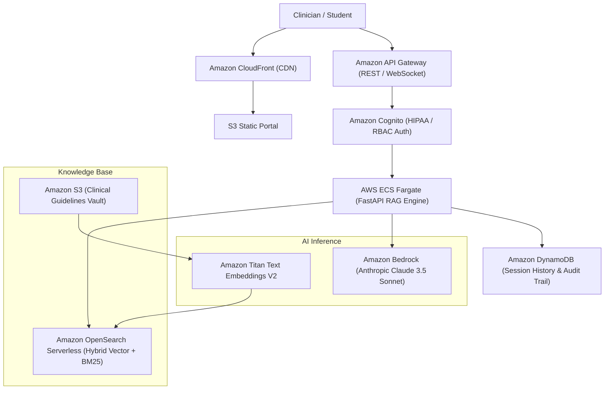

# MedBuddy — Clinical Decision Support & Medical Education RAG

[](#aws-cloud-architecture)
[](#rag-architecture)
[](#branch-architecture)
[](LICENSE)

> Grounded medical reasoning and clinical guideline synthesis platform powered by Amazon Bedrock, OpenSearch Serverless, and verifiable evidence citations.

---

## 1. Executive Brief
Clinical inquiry requires deterministic accuracy and verifiable citations to peer-reviewed literature. **MedBuddy** implements a hybrid Retrieval-Augmented Generation (RAG) system combining dense vector embeddings with lexical BM25 retrieval to synthesize clinical answers without factual hallucinations.

* **Consolidation**: Merged IBM Watsonx prototype into the canonical enterprise Bedrock stack.
* **Preservation Snapshot**: Original IBM Watson & LangChain prototypes preserved on [`Ex`](https://github.com/prak05/MedBuddy-Clinical-RAG/tree/Ex).
* **Target Architecture**: AWS Bedrock, OpenSearch Serverless, and ECS Fargate.

---

## 2. AWS Cloud Architecture



---

## 3. Engineering Improvements
1. **Hybrid Retrieval**: Combines semantic cosine similarity with BM25 keyword matching for medical acronyms and pharmacological dosages.
2. **Hallucination Guardrails**: Implements TruLens-style factuality validation scoring where citations are cross-referenced with source text offsets before streaming responses.
3. **Data Security**: AWS KMS envelope encryption for all in-transit and at-rest clinical queries.

---

## 4. Run & Deployment Runbook

### Local Quickstart
```bash
git clone https://github.com/prak05/MedBuddy-Clinical-RAG.git
cd MedBuddy-Clinical-RAG
python3 -m venv .venv && source .venv/bin/activate
pip install -r requirements.txt
uvicorn src.main:app --host 0.0.0.0 --port 8000
```

---

## 5. Branch Architecture
* [`main`](https://github.com/prak05/MedBuddy-Clinical-RAG/tree/main): Enterprise Bedrock RAG platform with OpenSearch and FastAPI.
* [`Ex`](https://github.com/prak05/MedBuddy-Clinical-RAG/tree/Ex): Preserved historical baseline.

<!-- antigravity-certified -->
